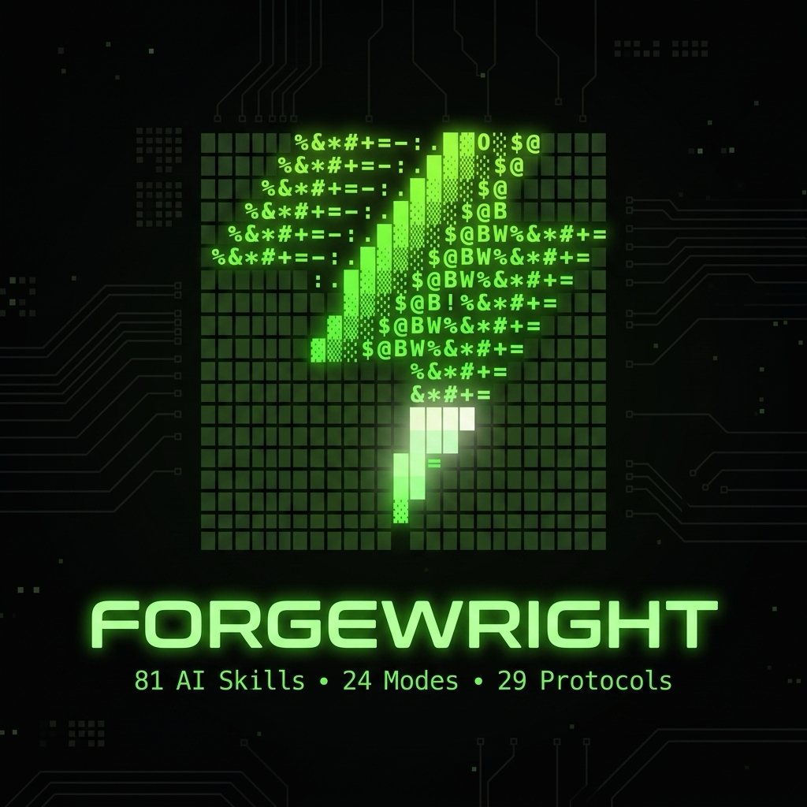
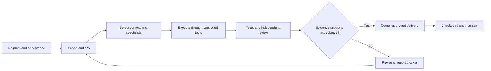

<!-- markdownlint-disable MD013 MD033 -->
# Forgewright

<p align="center">
  
</p>

<p align="center">
  <strong>From a prompt to an engineering workflow you can inspect, verify, and control.</strong>
</p>

<p align="center">
  
  
  
  
  
</p>

<p align="center">
  <a href="#what-forgewright-is">What it is</a> ·
  <a href="#how-it-helps-and-measured-impact">Why it helps</a> ·
  <a href="#how-it-works">How it works</a> ·
  <a href="#recent-upgrades">Recent upgrades</a> ·
  <a href="#quick-start">Quick start</a> ·
  <a href="#verification">Verification</a> ·
  <a href="README.vi.md">Tiếng Việt</a>
</p>

## What Forgewright is

**Forgewright is a local-first, provider-neutral engineering harness and orchestrator for AI coding agents** (Codex, Claude Code, Cursor, Antigravity, Gemini CLI/IDE, and Forge CLI).

Instead of relying on ad-hoc prompts or letting an agent edit files blindly and declare success without proof, Forgewright wraps your existing model runtime in a structured software delivery system:
- **85 canonical specialist skills** across **24 operating modes** (backend, frontend, fullstack, architecture, QA, security, DevOps, data/AI, mobile, Unity/Unreal/Godot/Phaser/Three.js game production, UX/UI, and product management).
- **Pre-tool execution guardrails** that block destructive commands and enforce project-owned safety policies across macOS, Linux, and Windows before a tool call runs.
- **Schema-v2 completion verification** that binds every completion claim to an exact command, exit code, output digest, acceptance criterion, and full worktree fingerprint (`TREE:<sha256>`).
- **Code intelligence & continuity** via GitNexus blast-radius analysis, bounded worker context packets, and a static local **Docs Hub** generated from canonical project state.

The [product manifest](product-manifest.json) and [capability inventory](docs/capability-maturity.json) keep every public count and maturity label tied to repository truth.

## How it helps and measured impact

| Common AI coding failure | How Forgewright solves it | Practical benefit |
| --- | --- | --- |
| Agent codes before understanding scope or risk | Proportional preflight (`QUICK` / `STANDARD` / `DEEP` / `HARD`) locks acceptance and minimum safe scope first | Fewer wasted edits, clear rollback paths, and mandatory deep review on payment/auth/schema changes |
| Every turn or subagent reloads huge instructions | Compact Kernel LITE boot table + on-demand `LITE.md` overlays + 64 KiB bounded worker packets | Keeps context focused on the active task instead of burning tokens on unrelated instructions |
| “It works” claimed from prose without running checks | Stop-gate validator (`stop_gate.py` + `verify_gate.py`) replays final commands and checks `TREE:<sha256>` | Blocks unverified completion claims; fixes require observed `RED → GREEN` (and mutation checks on `HARD` work) |
| Destructive shell commands or runaway browser tabs | Pre-tool `policy-check.sh` gate + Guardrail Rule 15 browser/emulator slot leases | Prevents accidental `git reset --hard` / `rm -rf` across POSIX and Windows and stops tab/process leaks |
| Parallel workers overwrite each other's files | Explicit file ownership contracts, git worktree isolation, and digest-bound `PLAN_LOCKED` handoffs | Safe parallel dispatch when scopes are independent; automatic serial fallback when coupled |
| Documentation and roadmap drift from real code | `forge docs gate` + `verify-product-truth.py` + `verify-roadmap-completion.py` in local CI | Enforces documentation continuity on material changes before commits land |

**Measured local runtime improvements (v8.7.1 checkout):**
- **Pre-tool policy gate (`scripts/lite/policy-check.sh`):** Reduced from ~145 ms to **~10 ms** on read calls (**~14× faster**) and **~29 ms** on git commands by replacing 30+ `grep`/`cut`/`tr` subshells with single-pass native Bash regex parsing.
- **Worktree fingerprinting (`scripts/lite/evidence_common.py`):** Reduced from ~663 ms to **~91 ms warm / ~176 ms cold** (**~3.8–7.2× faster**) via `git ls-files --directory` tree pruning, combined `git rev-parse`, bounded stat caching, and `__pycache__` exclusion.
- **Cross-platform Windows readiness:** Native support for Windows Python launchers (`python.exe`, `py.exe -3`, `Scripts/python.exe`), `cygpath` workspace normalization, Windows executable path matching (`.exe`, `.cmd`, `.bat`), and automatic Python JSON fallback when `jq` is absent.

## What you can build

- **Web products, APIs, and SaaS platforms:** Turn a product brief into architecture, database schemas, API contracts, frontend components, and E2E verification using the [Product Factory source](mcp/src/product-factory/) and fullstack specialist skills.
- **Games and mobile applications:** Coordinate game design, engine code, shaders, audio, QA, and device playtesting through the [Game Studio workflow](workflows/game-studio-build.md) and [Signal Dash Three.js reference fixture](tests/game/fixtures/threejs-lifecycle/README.md).
- **Brownfield production repositories:** Trace bugs, run upstream impact analysis with [GitNexus](docs/guides/gitnexus.md) before touching shared symbols, audit test value with the [QA protocol](skills/_shared/protocols/qa-test-protocol.md), and maintain architectural records in the [Docs Hub](docs/guides/docs-hub.md).

### A practical request

```text
Add save/continue to this game.

Preserve the current gameplay and existing tests.
Define acceptance for resume, corrupt saves, and duplicate rewards.
Inspect affected systems before editing.
Implement the smallest safe change, run the checks, and report:
  changed files · observed results · remaining risks · rollback
Do not publish or deploy without approval.
```

## How it works

`INTERPRET → DEFINE → BUILD → HARDEN → SHIP → SUSTAIN`



1. **Right-size the effort:** Clear local edits take the `QUICK` path (1–3 actions, focused check, zero ceremony). Feature or debug work takes `STANDARD`. Touching payment, billing, IAP, auth, public contracts, concurrency, or release triggers `DEEP` and `HARD` escalation ([ESCALATE.md](kernel/ESCALATE.md)).
2. **Route only the needed specialist:** The boot table selects one compact `LITE.md` skill overlay on demand instead of loading all **85 skills**.
3. **Gate every tool call and completion claim:** Pre-tool hooks validate commands against `.forgewright/execution-policy.yaml` ([POLICY.md](kernel/POLICY.md)). On completion, `stop_gate.py` verifies the exact-turn schema-v2 record in `.forgewright/verify/` ([VERIFY.md](kernel/VERIFY.md)).

See the [pipeline reference](docs/pipeline-reference.md) and [canonical runtime ADR](docs/adr/0001-canonical-production-runtime.md) for enforcement boundaries.

## Recent upgrades

### Game feel: control, fit and signature

[Designer guidance](skills/game-designer/references/game-feel.md) adds an action
card and 19 conditional checks within existing studio handoffs. Audio and VFX
budgets follow intent and target evidence. The extracted Three.js FollowCamera
now passes equal-elapsed 30/60/120Hz checks and rejects a fixed-frame mutation.
[Model/player/device uplift remains unmeasured](evals/skills/README.md).
Default web-game routes retain UI Designer within the existing context budget.

### 1. Windows & cross-platform hot-path optimization

- **Fast, zero-subshell policy validation:** [policy-check.sh](scripts/lite/policy-check.sh), [telemetry.sh](scripts/lite/telemetry.sh), and [rule-ledger.sh](scripts/lite/rule-ledger.sh) now parse policy files in pure Bash, resolve `python3`/`python`/`py.exe -3` across POSIX and Windows, normalize `FORGEWRIGHT_WORKSPACE` via `cygpath`, and fall back to Python when `jq` is not installed.
- **Windows destructive-command protection:** Structural command parsing normalizes Windows backslashes and `.exe`/`.cmd`/`.bat` suffixes so commands like `C:\\Program Files\\Git\\cmd\\git.exe reset --hard` or `git.cmd push --force` are blocked identically to POSIX paths.
- **Accelerated worktree fingerprinting:** [evidence_common.py](scripts/lite/evidence_common.py) prunes ignored directories via `git ls-files --directory`, caches large/mature file hashes in `.forgewright/cache/`, excludes `__pycache__` bytecode noise, and avoids false-positive `HARD` triggers on generated root instruction files (`AGENTS.md`, `CLAUDE.md`, `GEMINI.md`).

### 2. Codex & Claude plugin distribution + Behavioral Skill Quality Engine

Forgewright ships one unified plugin source for **Codex** and **Claude Code** ([plugin manifest](plugin.json)), exposing the entry workflow and **85 skills** with trigger-only descriptions and a consent-gated `PreToolUse` bootstrap hook ([auto-bootstrap.mjs](hooks/auto-bootstrap.mjs)). The [Skill Quality Engine](evals/skills/README.md) evaluates **baseline → current → candidate** behavior, minimal `PLAN_LOCKED` worker packets, and failure classification (`hypothesis_wrong`, `implementation_wrong`, `environment_wrong`, `architecture_wrong`).

### 3. Evidence loop: observation, context, and learning (ECC)

Project-isolated, opt-in observation ([Instinct System](skills/instinct-system/SKILL.md)), bounded 3-round/64 KiB worker context packets, native MCP candidate intake (`fw_record_learning_candidate`), and resumable handoffs ([architecture](docs/architecture.md#evidence-gated-learning-and-worker-context-protocols)):

```sh
npm run check:observer
npm run bench:ecc
npm run verify:ecc
python3 scripts/runtime/research_decision.py --help
python3 scripts/runtime/resumable_handoff.py --help
```

### 4. Conservative test lanes, browser tab guardrails, and game studio authority

- **Conservative local CI lanes ([local-ci.py](scripts/ci/local-ci.py)):** Precommit selects targeted lanes for MCP, CLI, or docs while keeping full fallback for shared runtime/script edits and enforcing the [QA test protocol](skills/_shared/protocols/qa-test-protocol.md).
- **Browser & emulator resource guardrails:** [Guardrail Rule 15](skills/_shared/protocols/guardrail.md#15-browser-tab-lifecycle--deny-fail-closed) caps interactive browser usage to 1 reused tab (max 2 task-wide) with mandatory teardown, while [Game Test Protocol](skills/_shared/protocols/game-test-protocol.md#managed-browser-and-emulator-resources) governs Three.js, Android, and iOS playtest admission slots.
- **Phase-scoped Game Studio & Game Designer:** [Game Designer](skills/game-designer/SKILL.md) and [game skill evolution](workflows/game-skill-evolution.md) honor studio phase gates and approved art direction without forcing universal visual recipes.
- **Bounded MCP cache & System-1 routing:** MCP result caching enforces 512 KiB/entry, 2 MiB/project, and 8 MiB/process limits; local EN/VI routing ([tool-efficiency.md](skills/_shared/protocols/tool-efficiency.md)) operates without external API keys.

The [studio workflow](workflows/game-studio-build.md) now has one phase activation
contract and a novice walkthrough; legacy gates defer to that flow. The
[eval guide](evals/skills/README.md) adds bounded Linux process cleanup, independent
judgments and exact comparison inputs. Product evidence stays separate from
skill decisions; missing metrics cannot become a pass. Live semantic promotion,
novice/player improvement and business uplift remain unverified. Existing
[Signal Dash](tests/game/fixtures/threejs-lifecycle/README.md#frozen-reference-and-approved-polish)
contract evidence is not a real-player comparison.

### 5. Optional Pi worker pilot (default-off, experimental)

The [Pi integration](integrations/pi/) provides an opt-in, host-governed worker option (`@earendil-works/pi-agent-core@0.85.1`) with account-level budgets, compare-and-swap patches, cancellation, and a shared SQLite host admission governor (192 MiB per Pi worker, 128 MiB per single-process verifier). See the [Pi ADR](docs/adr/ADR-pi-worker-runtime.md).

```bash
npm --prefix integrations/pi ci --ignore-scripts --no-audit --no-fund
npm run build && npm run build:cli
npm --prefix integrations/pi run test:all
```

From a parent project with the submodule:

```bash
node forgewright/src/cli/dist/index.js delegate on --worker pi --provider openai-codex --auth-source codex --model <exact-codex-model-id>
node forgewright/src/cli/dist/index.js delegate status --worker pi
node forgewright/src/cli/dist/index.js delegate run --worker pi --contract task.json
node forgewright/src/cli/dist/index.js delegate resources
```

### 6. Specialist research across all skills

The [skill catalog](docs/skill-catalog.md) covers **85 canonical skills and 3 aliases**,
with **168 profession-specific research questions**, domain verifiers and seven bounded
reference repairs (Game Engineer, API Designer, Solution Architect, MCP Generator,
Eval Engineer, SRE, XLSX Engineer). The MCP template pins GitNexus 1.6.12 and Node
`^22.18.0 || >=24.11.0` (verified on Linux/Node 24.19; Node 22/Windows and search
quality remain unverified). A Godot buffer candidate stays held on reconciliation
conflict; these are reference corrections, not model benchmarks or player-outcome proof.

### 5. Phaser 4 / Three.js production handoff

New 2D work uses **Phaser 4**, 3D **Three.js**, preserving legacy pins and manual
controls. The [router](scripts/runtime/skill_routing.py),
[experience checker](scripts/art-direction/game-experience.py) and optional
[UI kit](templates/game/ui-kit/README.md) connect flows, wireframes, concepts,
components and imports through existing [studio gates](skills/_shared/protocols/game-studio-pipeline.md).

[Phaser](tests/game/fixtures/phaser4-lifecycle/README.md) and
[Three.js](tests/game/fixtures/threejs-lifecycle/README.md#additional-experience-handoff-and-glb-pilot)
pilots have local build/contract/model checks. Browser runners compile before
admission; current cloud attempts were blocked (`pi_host_capacity_timeout`).
Rendered quality, specialist/player benefit and real-device performance remain
**UNVERIFIED**; synthetic approvals are conformance data.

Packaged Android/iOS uses the [monetization contract](skills/_shared/protocols/mobile-monetization.md)
and [integration kit](templates/game/mobile-monetization/README.md) for player/market
hypotheses, reusable nonsecret profiles and per-game strategy. `forge mobile`
setup and beta simulation separate provider availability from device evidence.
Native SDK/store adapters, account access and player/revenue gains still need
actual target-project validation.

### 7. Reverse-engineering intelligence & facet evidence

The [RE intelligence runtime](scripts/runtime/reverse_engineering_intelligence.py) and
[pinned catalog](.forgewright/re-discovery-catalog.json) add offline SHA-256-pinned
discovery, task-to-tool routing with explicit limitations, per-facet evidence envelopes
(`facet_availability`, `coverage.scope`, `coverage.status`), lease-bound process tokens
and full-precision benchmark ranking ([unit suite](tests/unit_tests/test_reverse_engineering_intelligence.py)).
Catalog metadata requires upstream license verification; fixture checks do not certify
external adapter execution or live model benchmarks.

## Quick start

### 1. Install as a Codex or Claude Code plugin (recommended)

**Codex CLI**

```bash
codex plugin marketplace add buiphucminhtam/forgewright --ref main
codex plugin add forgewright@forgewright-marketplace
```

**Claude Code**

```bash
claude plugin marketplace add buiphucminhtam/forgewright
claude plugin install forgewright@forgewright-marketplace --scope user
```

Verify both installers in isolated profiles: `npm run verify:plugins`.

### 2. Build the full local toolchain & Docs Hub

Requires **Node.js 22+**, **Python 3.11+**, and Git (Works on macOS, Linux, and Windows):

```bash
git clone https://github.com/buiphucminhtam/forgewright.git
cd forgewright
npm run ci:bootstrap
npm run build
npm run build:cli
node src/cli/dist/index.js --help
```

Initialize or onboard any local project without a model call, or build the local **Docs Hub** ([auto-bootstrap guide](docs/guides/auto-bootstrap.md), [Docs Hub guide](docs/guides/docs-hub.md)):

```bash
node src/cli/dist/index.js --json init /path/to/your-project
node src/cli/dist/index.js --json onboard /path/to/your-project
node src/cli/dist/index.js docs build .
node src/cli/dist/index.js docs doctor . --strict
```

### 3. Pin as a Git submodule (advanced)

```bash
git submodule add -b main https://github.com/buiphucminhtam/forgewright.git forgewright
git submodule update --init --recursive
bash forgewright/scripts/forgewright-mcp-setup.sh
```

## Core Capabilities

Maturity labels follow the [capability inventory](docs/capability-maturity.json): **beta** means automated local evidence, **experimental** means incomplete production evidence, and **docs-only** means a documented integration or workflow rather than a production runtime claim.

<details>
<summary><strong>Explore all 14 capability areas</strong></summary>

### 1. Code Intelligence (GitNexus)

**Docs-only integration.** Relationship navigation and impact analysis remain limited by stale indexes and dynamic code, and compatibility paths and user overrides are not universally enforced. [Guide](docs/guides/gitnexus.md).

### 2. Autonomous Testing Stack

**Beta.** Local checks, controlled mutations and acceptance-bound evidence with requirement-locked oracles. [Guide](docs/guides/testing-stack.md).

### 3. Persistent Cognitive Memory (FluxMem)

**Experimental.** Optional local SQLite/FTS5 memory with explicit semantic capture, separate project/chat scopes, bounded cited retrieval, read-only health status and consistent backups. Current evidence outranks memory; stored approvals grant no authority. Native automatic hooks and persistence after cloud recreation require host verification. [Commands and limits](skills/memory-manager/SKILL.md) · [reproducible retrieval eval](evals/memory/retrieval.json).

### 4. Parallel Skill Dispatch

**Experimental.** Owned lanes for independent tasks. Coupled work stays serial. [Pipeline](docs/pipeline-reference.md).

### 5. Multi-Project Hub

**Docs-only management integration.** Docs Hub separately implements local registration and static project views. [Guide](docs/guides/docs-hub.md).

### 6. Token Tracking & Cost Analytics

**Beta.** Reported usage, reservations and benchmarks distinguish measurements from estimates. [ForgeBench](src/cli/src/bench/).

### 7. MCP Tool Sandbox

**Beta application controls.** Admission, policy, containment and output bounds do not provide OS isolation. [Contract](docs/adr/0001-canonical-production-runtime.md).

### 8. The Adaptive Self-Improving Protocol (ASIP)

**Experimental legacy workflow.** Lessons need review before promotion. Repeated failures require new evidence or escalation. [Kernel](AGENTS.md).

### 9. Runtime Lifecycle Guard

**Beta.** Owned process leases, service reuse and cleanup accounting. No reclamation of unowned processes. [ADR](docs/adr/ADR-010-runtime-lifecycle-guard.md).

### 10. Game Studio Control Plane

**Beta optional pack.** Game production handoffs with project-specific builds, playtests and release evidence. [Workflow](workflows/game-studio-build.md).

### 11. Token Efficiency Engine & System-1 Routing (Jev Integration)

**Experimental.** Bounded local EN/VI routing with abstention. No default Jev model, download or cloud routing call. [Protocol](skills/_shared/protocols/tool-efficiency.md).

### 12. Optional Pi Worker Pilot

**Experimental, opt-in.** Scoped coding workers, immutable verifiers, cancellation and shared admission. No production or paired-savings claim. [ADR](docs/adr/ADR-pi-worker-runtime.md).

### 13. Codex & Claude Plugin Distribution

**Beta.** Shared source, lazy discovery, isolated install checks and consent-gated bootstrap. [ADR](docs/adr/ADR-agent-plugin-distribution.md).

### 14. Behavioral Skill Quality Engine

**Experimental.** Deterministic behavioral scenarios and promotion gates. Fixture results do not establish real-model gains. [Skill evals](evals/skills/README.md).

</details>

## Verification

All verification gates are local-first and provider-neutral. Check [canonical project status](docs/project-state.json) and the [roadmap completion manifest](docs/roadmap-completion.json), which separates **implementation, integration, activation, production evidence, and measured outcome**.

```bash
npm run lint && npm run build && npm test
npm run typecheck:cli && npm run build:cli
npm run ci:docs
npm run verify:product-truth
npm run verify:roadmap
npm run verify:plugins
python3 scripts/ci/verify-readme.py
npm run ci:local
```

### Trust boundaries

Execution stays within your configured provider ecosystem. Local-first does not prevent remote models from receiving prompts or selected code unless you configure a local model runtime. Tool containment is application-level, not an OS kernel sandbox, and keyless `review-2` attestations bind exact evidence digests without authenticating against same-user forgery. See [SECURITY.md](SECURITY.md) and [release readiness](docs/process/release-readiness.md).

## Documentation & contributing

| Guide | Purpose |
| --- | --- |
| [Product overview](docs/product-overview.md) | Scope, supported surfaces, and delivery model |
| [Architecture](docs/architecture.md) / [pipeline](docs/pipeline-reference.md) | System components, ownership, and execution flow |
| [Quickstart](docs/guides/forge-init-onboard.md) / [Docs Hub](docs/guides/docs-hub.md) | Project onboarding and local documentation portal |
| [Visual grounding](skills/_shared/protocols/visual-grounding.md) | Evidence-based UI/UX and art direction rules |
| [Unity setup](docs/unity-mcp-setup.md) / [Game tests](tests/game/README.md) | Game engine integration and playable fixtures |
| [Active roadmap](docs/active-roadmap.md) / [Changelog](CHANGELOG.md) | Current status, blockers, and release history |

Report issues via [GitHub issues](https://github.com/buiphucminhtam/forgewright/issues) and security findings via [SECURITY.md](SECURITY.md). Review package-specific license declarations such as [the CLI MIT license](src/cli/package.json) before redistribution.

**Build with more leverage. Ship with evidence.**
