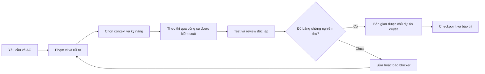

<!-- markdownlint-disable MD013 MD033 -->
# Forgewright

<p align="center">
  
</p>

<p align="center"><strong>Từ một yêu cầu đến quy trình kỹ thuật có thể kiểm tra, kiểm chứng và kiểm soát.</strong></p>

<p align="center">
  
  
  
  
  
</p>

<p align="center">
  <a href="#forgewright-là-gì">Dự án là gì</a> ·
  <a href="#giúp-ích-được-gì-và-hiệu-quả-thực-tế">Hiệu quả</a> ·
  <a href="#cách-hoạt-động">Cách hoạt động</a> ·
  <a href="#những-nâng-cấp-gần-đây">Nâng cấp gần đây</a> ·
  <a href="#bắt-đầu">Bắt đầu</a> ·
  <a href="#kiểm-chứng">Kiểm chứng</a> ·
  <a href="README.md">English</a>
</p>

## Forgewright là gì

**Forgewright là bộ khung điều phối kỹ thuật (engineering harness & orchestrator) local-first, không phụ thuộc nhà cung cấp model, dành cho các AI coding agent** (Codex, Claude Code, Cursor, Antigravity, Gemini CLI/IDE và Forge CLI).

Thay vì để AI đọc prompt rồi sửa file tùy ý và tự tuyên bố “đã xong”, Forgewright đặt agent vào một quy trình kỹ thuật có kỷ luật:
- **85 kỹ năng chuyên gia (canonical skills)** trên **24 chế độ vận hành (modes)**: từ Backend, Frontend, Fullstack, Kiến trúc, QA, Bảo mật, DevOps, AI/Data cho tới Mobile và phát triển Game (Unity, Unreal, Godot, Phaser 4, Three.js).
- **Cổng kiểm soát công cụ trước khi chạy (Pre-tool Guardrails):** Chặn lệnh phá hủy dữ liệu, giới hạn mở dư tab trình duyệt/emulator và áp dụng chính sách an toàn trên cả **macOS, Linux và Windows**.
- **Nghiệm thu bằng bằng chứng thực thi (Schema-v2 Evidence):** Mọi tuyên bố hoàn thành phải gắn với lệnh kiểm tra thực tế, mã thoát `0`, mã băm `OUTPUT: sha256:...`, tiêu chí nghiệm thu (AC) và chữ ký toàn bộ cây thư mục (`TREE:<sha256>`).
- **Trí tuệ mã nguồn & tính liên tục dự án:** Kết hợp đồ thị mã nguồn [GitNexus](docs/guides/gitnexus.md), gói ngữ cảnh tối thiểu cho worker và cổng tài liệu tĩnh **Docs Hub** sinh trực tiếp từ trạng thái chuẩn của dự án.

Mọi số liệu về phiên bản, số lượng kỹ năng và mức độ trưởng thành đều được đối chiếu tự động qua [product manifest](product-manifest.json) và [capability inventory](docs/capability-maturity.json).

## Giúp ích được gì và hiệu quả thực tế

| Vấn đề thường gặp khi dùng AI viết code | Cách Forgewright giải quyết | Giá trị mang lại cho đội ngũ |
| --- | --- | --- |
| AI sửa code ngay khi chưa hiểu rõ phạm vi và rủi ro | Phân loại độ sâu (`QUICK` / `STANDARD` / `DEEP` / `HARD`), khóa tiêu chí nghiệm thu và phạm vi an toàn tối thiểu trước | Giảm sửa sai lan man; các tác vụ nhạy cảm (thanh toán, bảo mật, schema) bắt buộc qua kiểm tra đa tầng và review độc lập |
| Tốn hàng nghìn token nạp lại toàn bộ quy tắc mỗi lượt | Bảng định tuyến gọn nhẹ ở `AGENTS.md`/`CLAUDE.md`, chỉ nạp overlay `LITE.md` khi cần và giới hạn gói worker ở 64 KiB | Tiết kiệm context window, giữ agent tập trung vào đúng phạm vi công việc |
| AI báo “xong” nhưng chưa chạy test hoặc test giả | Cổng `stop_gate.py` + `verify_gate.py` chạy lại lệnh kiểm tra trên cây thư mục cuối cùng và đối chiếu `TREE:<sha256>` | Chặn báo cáo ảo; sửa lỗi bắt buộc chứng minh `RED → GREEN` thực tế |
| Lệnh shell nguy hiểm hoặc rò rỉ tiến trình/tab trình duyệt | Cổng `policy-check.sh` + Guardrail Rule 15 quản lý lease cho tiến trình, tab trình duyệt và emulator | Chặn `git reset --hard`, `rm -rf` trên cả POSIX lẫn Windows; tự động thu hồi tài nguyên sau khi chạy |
| Nhiều sub-agent sửa đè lên file của nhau | Hợp đồng sở hữu file tường minh, cô lập bằng git worktree và gói `PLAN_LOCKED` có gắn mã băm | Điều phối song song an toàn khi các phần độc lập; giữ tuần tự khi phụ thuộc |
| Tài liệu và roadmap lệch pha với code thực tế | Cổng `forge docs gate` + `verify-product-truth.py` + `verify-roadmap-completion.py` trong Local CI | Đảm bảo tài liệu luôn đồng bộ với mọi thay đổi quan trọng trước khi commit |

**Hiệu quả đo đạc thực tế trên bản `v8.7.1`:**
- **Tốc độ cổng kiểm tra chính sách (`scripts/lite/policy-check.sh`):** Giảm từ ~145 ms xuống **~10 ms** cho lệnh đọc (**nhanh hơn ~14,5×**) và **~29 ms** cho lệnh `git` nhờ loại bỏ hơn 30 tiến trình con `grep`/`cut`/`tr` và xử lý bằng regex nội sinh của Bash.
- **Tốc độ băm cây thư mục (`worktree_fingerprint` trong `evidence_common.py`):** Giảm từ ~663 ms xuống **~91 ms (warm) / ~176 ms (cold)** (**nhanh hơn ~3,8–7,2×**) nhờ cắt nhánh `node_modules` bằng `git ls-files --directory`, gộp `git rev-parse`, bổ sung stat-cache và loại trừ nhiễu bytecode `__pycache__`.
- **Sẵn sàng cho Windows + macOS + Linux:** Tự động nhận diện Python trên Windows (`python.exe`, `py.exe -3`, `Scripts/python.exe`), chuẩn hóa đường dẫn `cygpath`, chặn lệnh nguy hiểm dạng `.exe`/`.cmd`/`.bat` và chạy độc lập không cần cài `jq`.

## Dùng cho việc gì

- **Xây dựng sản phẩm Web, API và SaaS:** Chuyển yêu cầu sản phẩm thành kiến trúc, schema cơ sở dữ liệu, API contract, giao diện và bộ kiểm thử E2E thông qua [Product Factory](mcp/src/product-factory/).
- **Phát triển Game và ứng dụng Mobile:** Phối hợp xuyên suốt từ thiết kế gameplay, lập trình engine, shader, âm thanh đến QA và playtest bằng [Game Studio workflow](workflows/game-studio-build.md) cùng game mẫu [Signal Dash (Three.js)](tests/game/fixtures/threejs-lifecycle/README.md).
- **Bảo trì & nâng cấp codebase lớn:** Truy vết lỗi, phân tích phạm vi ảnh hưởng (blast radius) với [GitNexus](docs/guides/gitnexus.md) trước khi sửa hàm dùng chung, kiểm toán chất lượng test theo [QA protocol](skills/_shared/protocols/qa-test-protocol.md) và quản lý tri thức dự án qua [Docs Hub](docs/guides/docs-hub.md).

### Một yêu cầu thực tế

```text
Thêm save/continue cho game này.

Giữ nguyên gameplay và các test hiện có.
Xác định AC cho resume, save hỏng và nhận thưởng trùng.
Kiểm tra các hệ thống bị ảnh hưởng trước khi sửa.
Triển khai thay đổi nhỏ nhất đủ an toàn, chạy kiểm tra và báo cáo:
  file đã sửa · kết quả quan sát được · rủi ro còn lại · cách rollback
Không publish hoặc deploy khi chưa được duyệt.
```

## Cách hoạt động

`INTERPRET → DEFINE → BUILD → HARDEN → SHIP → SUSTAIN`



1. **Định cỡ nỗ lực theo rủi ro (Right-size):** Việc nhỏ, cục bộ, dễ hoàn tác đi theo luồng `QUICK` (1–3 bước, 1 lệnh kiểm tra trọng tâm). Tính năng/sửa lỗi thông thường đi theo `STANDARD`. Các thay đổi chạm tới thanh toán (payment/billing/IAP), xác thực, hợp đồng API công khai, đồng thời (concurrency) hoặc phát hành bắt buộc nâng lên `DEEP` và `HARD` ([ESCALATE.md](kernel/ESCALATE.md)).
2. **Định tuyến chuyên gia theo nhu cầu:** Chỉ nạp overlay `LITE.md` của kỹ năng cần thiết thay vì nạp toàn bộ 85 kỹ năng vào đầu phiên.
3. **Kiểm chứng từng bước và tại cổng kết thúc:** Mọi lệnh gọi công cụ được kiểm tra qua `.forgewright/execution-policy.yaml` ([POLICY.md](kernel/POLICY.md)), và khi kết thúc lượt, `stop_gate.py` đối chiếu bản ghi schema-v2 trong `.forgewright/verify/` ([VERIFY.md](kernel/VERIFY.md)).

Xem chi tiết tại [pipeline reference](docs/pipeline-reference.md) và [canonical runtime ADR](docs/adr/0001-canonical-production-runtime.md).

## Những nâng cấp gần đây

### Game feel: điều khiển, sự phù hợp và bản sắc

[Hướng dẫn Designer](skills/game-designer/references/game-feel.md) có action card
và checklist 19 trường hợp trong handoff hiện có; audio/VFX theo chức năng và
target thực tế. Regression chạy chính ví dụ FollowCamera ở 30/60/120Hz và bắt
mutation theo frame. [Cải thiện model/người chơi/thiết bị chưa được đo](evals/skills/README.md).
Router giữ UI Designer trong budget context hiện có.

### 1. Tối ưu hóa đường nóng (Hot-path) & Hỗ trợ toàn diện Windows

- **Kiểm tra chính sách tức thời, không phụ thuộc `jq`:** [policy-check.sh](scripts/lite/policy-check.sh), [telemetry.sh](scripts/lite/telemetry.sh) và [rule-ledger.sh](scripts/lite/rule-ledger.sh) phân tích cấu hình trực tiếp bằng Bash, tự động dò `python3`/`python`/`py.exe -3` trên Windows lẫn POSIX, chuẩn hóa `FORGEWRIGHT_WORKSPACE` qua `cygpath` và tự fallback sang Python khi máy không có `jq`.
- **Chặn lệnh phá hủy định dạng Windows:** Bộ phân tích cấu trúc lệnh chuẩn hóa dấu `\\` và hậu tố `.exe`/`.cmd`/`.bat`, chặn chính xác các lệnh như `C:\\Program Files\\Git\\cmd\\git.exe reset --hard` hoặc `git.cmd push --force`.
- **Tăng tốc `worktree_fingerprint` & làm sạch `.forgewright/`:** [evidence_common.py](scripts/lite/evidence_common.py) dùng `git ls-files --directory` để cắt nhánh thư mục `node_modules` và runtime ngay từ tầng C của Git, lưu đệm chữ ký stat cho file lớn/ổn định, loại trừ `__pycache__` và tránh cảnh báo giả `HARD` khi cập nhật các file hướng dẫn gốc (`AGENTS.md`, `CLAUDE.md`, `GEMINI.md`).

### 2. Đóng gói Plugin cho Codex & Claude + Behavioral Skill Quality Engine

Cùng một nguồn `skills/` được đóng gói thành plugin chuẩn cho cả **Codex** và **Claude Code** ([plugin manifest](plugin.json)) với cơ chế nạp kỹ năng theo ngữ cảnh và hook `PreToolUse` chỉ hoạt động khi người dùng chủ động bật ([auto-bootstrap.mjs](hooks/auto-bootstrap.mjs)). [Skill Quality Engine](evals/skills/README.md) đo lường **baseline → current → candidate**, biên dịch gói ngữ cảnh tối thiểu `PLAN_LOCKED` cho worker và phân loại lỗi (`hypothesis_wrong`, `implementation_wrong`, `environment_wrong`, `architecture_wrong`).

### 3. Vòng lặp bằng chứng: Quan sát, Ngữ cảnh và Học có kiểm soát (ECC)

Bổ sung cơ chế quan sát theo từng dự án ([Instinct System](skills/instinct-system/SKILL.md)), gói ngữ cảnh phụ trợ giới hạn 3 vòng / 64 KiB cho worker, công cụ MCP `fw_record_learning_candidate` (chỉ tạo đề xuất chờ duyệt) và bàn giao phiên có thể tiếp tục ([kiến trúc ECC](docs/architecture.md#evidence-gated-learning-and-worker-context-protocols)):

```sh
npm run check:observer
npm run bench:ecc
npm run verify:ecc
python3 scripts/runtime/research_decision.py --help
python3 scripts/runtime/resumable_handoff.py --help
```

### 4. Chọn làn test thông minh, Guardrail trình duyệt & Chuẩn hóa Game Studio

- **Chọn làn kiểm thử bảo toàn ([local-ci.py](scripts/ci/local-ci.py)):** Precommit tự động chọn làn test phù hợp (MCP, CLI, Docs) kèm hợp đồng kiểm tra chéo Python, giữ fallback toàn diện khi sửa runtime chung và áp dụng [QA test protocol](skills/_shared/protocols/qa-test-protocol.md).
- **Guardrail quản lý tab trình duyệt & thiết bị test game:** [Guardrail Rule 15](skills/_shared/protocols/guardrail.md#15-browser-tab-lifecycle--deny-fail-closed) giới hạn tái sử dụng 1 tab tương tác (tối đa 2 tab toàn tác vụ) và bắt buộc dọn dẹp; [Game Test Protocol](skills/_shared/protocols/game-test-protocol.md#managed-browser-and-emulator-resources) cấp phát slot cho Three.js, Android emulator và iOS simulator.
- **Game Designer & tiến hóa kỹ năng dựa trên bằng chứng:** [Game Designer](skills/game-designer/SKILL.md) và [workflow nâng cấp skill game](workflows/game-skill-evolution.md) tôn trọng art direction đã duyệt theo từng pha thay vì áp đặt một công thức hiệu ứng cứng nhắc; đi kèm fixture chơi được [Signal Dash](tests/game/fixtures/threejs-lifecycle/README.md), [hướng dẫn test game](tests/game/README.md) và [cài đặt Unity MCP](docs/unity-mcp-setup.md).
- **Giới hạn bộ nhớ đệm MCP & định tuyến System-1:** Cache MCP giới hạn 512 KiB/entry, 2 MiB/project, 8 MiB/process; định tuyến ngữ nghĩa tiếng Việt/Anh nội bộ ([tool-efficiency.md](skills/_shared/protocols/tool-efficiency.md)) không cần khóa API ngoài.

Studio dùng một bảng kích hoạt theo phase và có hướng dẫn người mới.
[Eval game](evals/skills/README.md) thêm dọn tiến trình Linux, đánh giá độc lập và
đối chiếu đúng đầu vào; thiếu số liệu không được thành PASS. Skill mới chưa
được promote bằng model thật. Cải thiện sản phẩm, người mới và doanh thu vẫn
**UNVERIFIED**; contract replay không thay thế bằng chứng này.

### 5. Pi Worker tùy chọn (experimental, tắt mặc định)

[Tích hợp Pi](integrations/pi/) cung cấp tùy chọn chạy worker cô lập (`@earendil-works/pi-agent-core@0.85.1`) dưới sự kiểm soát của Forgewright: ngân sách theo tài khoản, patch đối chiếu mã băm, hủy tác vụ và bộ điều phối tài nguyên SQLite (192 MiB/worker, 128 MiB/verifier). Xem chi tiết tại [Pi ADR](docs/adr/ADR-pi-worker-runtime.md).

```bash
npm --prefix integrations/pi ci --ignore-scripts --no-audit --no-fund
npm run build && npm run build:cli
npm --prefix integrations/pi run test:all
```

Chạy từ dự án cha có gắn submodule:

```bash
node forgewright/src/cli/dist/index.js delegate on --worker pi --provider openai-codex --auth-source codex --model <exact-codex-model-id>
node forgewright/src/cli/dist/index.js delegate status --worker pi
node forgewright/src/cli/dist/index.js delegate run --worker pi --contract task.json
node forgewright/src/cli/dist/index.js delegate resources
```

### 6. Research chuyên môn trên toàn bộ skill

[Catalog](docs/skill-catalog.md) ghi **85 skill chính, 3 alias, 168 câu hỏi**,
bảy bản sửa reference và giới hạn bằng chứng. MCP pin GitNexus 1.6.12 và Node
`^22.18.0 || >=24.11.0`; mới kiểm SDK/CLI trên Linux/Node 24.19. Candidate Godot
còn giữ lại vì xung đột reconciliation. Chưa chứng minh model/game feel tốt hơn.

### 5. Hoàn thiện handoff game Phaser 4 / Three.js

2D mới dùng **Phaser 4**, 3D **Three.js**, giữ project/pin cũ.
[Router](scripts/runtime/skill_routing.py), [checker](scripts/art-direction/game-experience.py)
và [UI kit](templates/game/ui-kit/README.md) nối flow, wireframe, concept và asset
qua [studio](skills/_shared/protocols/game-studio-pipeline.md).
[Pilot Phaser](tests/game/fixtures/phaser4-lifecycle/README.md) và
[Three.js](tests/game/fixtures/threejs-lifecycle/README.md#additional-experience-handoff-and-glb-pilot)
có build/contract/model checks; runner compile trước admission. Browser cloud
bị chặn (`pi_host_capacity_timeout`): render, thiết bị, specialist/người chơi còn
**UNVERIFIED**. Approval tổng hợp trong fixture không duyệt production.

## Bắt đầu

### 1. Cài đặt dưới dạng Plugin cho Codex hoặc Claude Code (khuyến nghị)

**Codex CLI**

```bash
codex plugin marketplace add buiphucminhtam/forgewright --ref main
codex plugin add forgewright@forgewright-marketplace
```

**Claude Code**

```bash
claude plugin marketplace add buiphucminhtam/forgewright
claude plugin install forgewright@forgewright-marketplace --scope user
```

Kiểm tra cài đặt plugin trong môi trường cô lập: `npm run verify:plugins`.

### 2. Cài đặt bộ công cụ đầy đủ & Docs Hub (macOS, Linux, Windows)

Yêu cầu **Node.js 22+**, **Python 3.11+** và Git:

```bash
git clone https://github.com/buiphucminhtam/forgewright.git
cd forgewright
npm run ci:bootstrap
npm run build
npm run build:cli
node src/cli/dist/index.js --help
```

Khởi tạo/onboard dự án bất kỳ mà không tốn lượt gọi model, hoặc dựng cổng tài liệu **Docs Hub** ([hướng dẫn auto-bootstrap](docs/guides/auto-bootstrap.md), [hướng dẫn Docs Hub](docs/guides/docs-hub.md)):

```bash
node src/cli/dist/index.js --json init /path/to/your-project
node src/cli/dist/index.js --json onboard /path/to/your-project
node src/cli/dist/index.js docs build .
node src/cli/dist/index.js docs doctor . --strict
```

### 3. Gắn cố định vào dự án bằng Git Submodule (nâng cao)

```bash
git submodule add -b main https://github.com/buiphucminhtam/forgewright.git forgewright
git submodule update --init --recursive
bash forgewright/scripts/forgewright-mcp-setup.sh
```

## Năng lực và độ trưởng thành

Nhãn độ trưởng thành tuân theo [capability inventory](docs/capability-maturity.json): **Beta** là đã có kiểm chứng tự động local, **Experimental** là đang thử nghiệm/chưa đủ bằng chứng production, và **Docs-only** là quy trình/tích hợp tài liệu hóa.

| Nhóm năng lực | Độ trưởng thành | Giá trị cốt lõi |
| --- | --- | --- |
| Code Intelligence / GitNexus | Docs-only | Đồ thị quan hệ mã nguồn và phân tích ảnh hưởng trước khi sửa ([hướng dẫn](docs/guides/gitnexus.md)) |
| Autonomous Testing Stack | Beta | Kiểm thử gắn AC, property-based testing và bảo vệ test oracle ([hướng dẫn](docs/guides/testing-stack.md)) |
| Persistent Cognitive Memory / FluxMem | Experimental | SQLite/FTS5 local, tách project/chat, capture có receipt và context có citation/giới hạn; bằng chứng hiện tại luôn ưu tiên hơn memory |
| Parallel Skill Dispatch | Experimental | Chia làn worker độc lập có kiểm soát phạm vi file; giữ tuần tự khi phụ thuộc |
| Multi-Project Hub | Docs-only | Định hướng quản trị đa dự án tách biệt với Docs Hub tĩnh hiện có |
| Token Tracking & Cost Analytics | Beta | Theo dõi chi phí, hạn mức và benchmark ([ForgeBench](src/cli/src/bench/)) |
| MCP Tool Sandbox | Beta | Kiểm soát chính sách, phạm vi và đầu ra công cụ ở tầng ứng dụng |
| ASIP | Experimental | Lưu bài học kinh nghiệm có kiểm duyệt và quy tắc dừng khi lặp lỗi ([Kernel](AGENTS.md)) |
| Runtime Lifecycle Guard | Beta | Quản lý lease và thu hồi tiến trình thuộc quyền sở hữu ([ADR](docs/adr/ADR-010-runtime-lifecycle-guard.md)) |
| Game Studio Control Plane | Beta | Quy trình bàn giao theo pha cho dự án game ([workflow](workflows/game-studio-build.md)) |
| Token Efficiency / System-1 Routing | Experimental | Định tuyến EN/VI nội bộ có giới hạn, tự dừng khi yêu cầu mơ hồ |
| Optional Pi Worker Pilot | Experimental, tắt mặc định | Worker cô lập có kiểm soát ngân sách và điều phối tài nguyên đa dự án |
| Codex & Claude Plugin Distribution | Beta | Nguồn plugin chung, nạp kỹ năng thông minh và auto-bootstrap có xin phép ([ADR](docs/adr/ADR-agent-plugin-distribution.md)) |
| Behavioral Skill Quality Engine | Experimental | Đánh giá hành vi kỹ năng và cổng kiểm duyệt trước khi nâng cấp ([evals](evals/skills/README.md)) |

## Kiểm chứng

Mọi cổng kiểm chứng đều chạy trực tiếp trên máy local. Xem [trạng thái chuẩn của dự án](docs/project-state.json) và [roadmap completion manifest](docs/roadmap-completion.json) (tách bạch rõ **implementation, integration, activation, production evidence và measured outcome**).

```bash
npm run lint && npm run build && npm test
npm run typecheck:cli && npm run build:cli
npm run ci:docs
npm run verify:product-truth
npm run verify:roadmap
npm run verify:plugins
python3 scripts/ci/verify-readme.py
npm run ci:local
```

### Ranh giới tin cậy

Thực thi nằm trong hệ sinh thái model/provider bạn cấu hình; nếu dùng model đám mây, prompt và đoạn code được chọn vẫn gửi tới provider đó trừ khi cấu hình model nội bộ. Kiểm soát công cụ ở tầng ứng dụng không thay thế OS sandbox, và chữ ký `review-2` không khóa mật mã giúp phát hiện sai lệch dữ liệu nhưng không chống giả mạo từ cùng tài khoản người dùng. Xem thêm tại [SECURITY.md](SECURITY.md) và [release readiness](docs/process/release-readiness.md).

## Tài liệu và đóng góp

| Tài liệu | Nội dung |
| --- | --- |
| [Product overview](docs/product-overview.md) | Phạm vi, các môi trường hỗ trợ và mô hình vận hành |
| [Architecture](docs/architecture.md), [pipeline](docs/pipeline-reference.md) | Kiến trúc hệ thống, quyền sở hữu và luồng thực thi |
| [Init/onboard](docs/guides/forge-init-onboard.md), [Docs Hub](docs/guides/docs-hub.md) | Khởi tạo dự án và cổng tài liệu tĩnh |
| [Visual grounding](skills/_shared/protocols/visual-grounding.md) | Quy chuẩn thiết kế giao diện và art direction dựa trên bằng chứng |
| [Active roadmap](docs/active-roadmap.md), [Changelog](CHANGELOG.md) | Lộ trình hiện tại, các điểm nghẽn và lịch sử phát hành |

Báo lỗi hoặc đề xuất tính năng tại [GitHub issues](https://github.com/buiphucminhtam/forgewright/issues); báo cáo bảo mật theo [SECURITY.md](SECURITY.md). Kiểm tra license của từng gói (như [khai báo MIT của CLI](src/cli/package.json)) trước khi phân phối lại.

**Tăng sức làm việc. Bàn giao bằng bằng chứng.**

Memory hỗ trợ lưu quyết định/blocker/handoff chọn lọc, tắt được, đọc lại qua process mới và backup SQLite nhất quán. Đây không phải kho transcript đầy đủ; hook tự động của host và việc giữ dữ liệu qua lần tái tạo cloud vẫn cần kiểm chứng riêng. Xem [lệnh, phạm vi và migration](skills/memory-manager/SKILL.md) cùng [bộ eval Việt/Anh cố định](evals/memory/retrieval.json).
